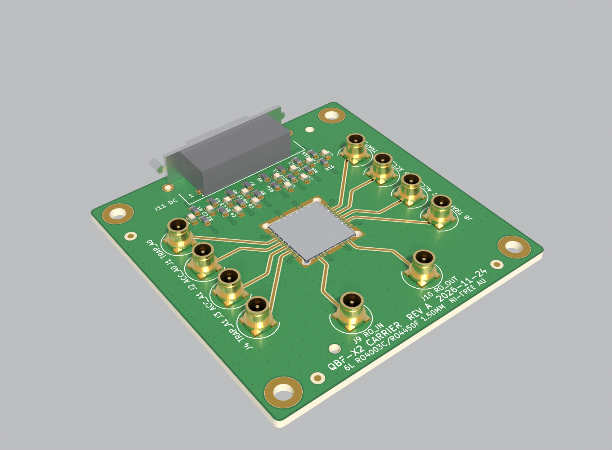

# QBF-X2 cryogenic RF carrier PCB (rev A, 2026-11-24)

A 6-layer Rogers RO4003C / RO4450F carrier for the 10 x 10 mm QBF-X2 superconducting die. The die sits in a
10.30 mm through-window on a pedestal of the copper sample-holder base, with its top
flush with the board. It is wire bonded to 24 landing pads that follow `../circuits/die_pads.json`, the chip-to-board
contract. The 8 fast flux lines and 2 readout lines run as mask-free 50-ohm grounded CPW on the top layer to 10
non-magnetic SMP jacks. The 8 DC lines run as striplines on In2 to on-board RC filters next to a micro-D connector.

Everything is generated by Python from `carrier_params.py`; nothing was drawn by hand. KiCad 7.0.11 (`kicad-cli` and the
`pcbnew` module) fills the zones, runs DRC and writes every fabrication output.



| | |
|---|---|
| Board | 52 x 52 mm, 1.50 mm, 6 Cu layers, through vias only |
| Parts | 44 schematic parts (39 on the PCBA), 5 board-only (3 fiducials, 2 dowel holes) |
| Nets | 35: 10 RF, 24 DC (8 die-side, 8 connector-side, 8 filter nodes), GND |
| Vias | 862: 834 GND stitching / fences / launch cages, 16 DC transitions, 12 filter-cap GND |
| DRC (pcbnew 7.0.11) | **0 violations, 0 unconnected, 0 footprint errors** |
| Schematic vs PCB | **0 mismatches** (44 components, 120 pads) |
| RF impedance | rf_calc formula 51.98 ohm; 2D field solve (35 um Cu) 47.66 ohm; target 50 +/-5 % |
| A/B length match | all pairs 0.0000 mm (limit 0.20 mm) |
| Filters | gate 596 Hz (<= 10 kHz); load 17.7 MHz into the load loop, 8.84 MHz open |

## Files

| Path | What |
|---|---|
| `carrier_params.py` | single source of truth: geometry, stackup, rules, filter values, parts |
| `build_carrier.py` + `carrier_lib/` | writes the KiCad project from scratch (schematic, libraries, 3D models, routed board, rules) |
| `finalize_carrier.py` | KiCad zone fill + DRC (pcbnew, as in QFX-1's `finalize_pcb.py`) |
| `check_carrier.py` | schematic-vs-PCB, ERC substitute, impedance, lengths, filters, DRC fault injection |
| `make_outputs.py`, `render_3d.py`, `make_readme.py` | BOM, drawings, previews, 3D renders, this README |
| `export_carrier.sh` | runs everything: rebuilds every file below |
| `qbfx2_carrier.kicad_pro/.kicad_sch/.kicad_pcb/.kicad_dru` | the KiCad 7 project (zones filled) |
| `qbfx2.kicad_sym`, `qbfx2.pretty/`, `sym-lib-table`, `fp-lib-table`, `3dmodels/` | project libraries (inline copies are in the sheet and the board) |
| `fab/gerbers/` | Gerber X2: 6 copper, 2 mask, 2 paste, 2 silk, Edge.Cuts, fab-notes layer, `.gbrjob` |
| `fab/drill/` | Excellon PTH + NPTH (mm, origin = board lower-left) and drill-map PDFs |
| `fab/assembly/qbfx2_carrier-pos.csv` | pick-and-place (mm, both sides, origin = board lower-left) |
| `fab/qbfx2_carrier_bom.csv` | BOM with manufacturer, MPN, MPN status |
| `fab/qbfx2_carrier-schematic.pdf` | schematic (A3) |
| `fab/qbfx2_carrier-fab_drawing.pdf` | fabrication drawing: outline + dimensions, stackup, impedance and drill tables, fab notes, then drill maps |
| `fab/qbfx2_carrier-assembly.pdf` | assembly drawing: 3:1 top detail, wire-bond diagram, notes, BOM summary, J11 pinout, RF lengths |
| `fab/qbfx2_carrier.step` | 3D STEP of the assembled board (KiCad export with the generated OCP models) |
| `fab/qbfx2_carrier.net` | schematic netlist (KiCad s-expression) |
| `fab/previews/` | PNG previews: top/bottom, each copper layer, die area, In2 routing, drawings, 3D renders |
| `reports/` | DRC report, all check reports, `check_summary.json`, build model, logs |

## Board

**Die interface.** The landing pads (footprint U1, pads 1-24 = die launcher ids) sit 0.10 mm from the
window edge. They are 0.39 x 0.60 mm, on the same 1.2 mm pitch as the die launchers and laterally
aligned with them (offset 0), so every bond is straight and about 0.8 mm long. The window is
10.30 mm (0.15 mm clearance), with R0.60 corner reliefs that clear the die
corners. Between the pads the ground copper is exposed (F.Mask openings over GND only) for ground bonds; the corners are
exposed as well. The first ground-via row is at 6.5 mm from the die centre, in every strip between landing pads.

**RF lines (10).**
- Cross-section: grounded CPW on F.Cu over the solid In1 plane, w 0.39 mm, gap 0.17 mm, h 0.203 mm RO4003C.
- Mask-free: the F.Mask opening covers the trace and both gaps and stops 0.01 mm short of the ground copper.
- Bends: every bend is a tangent arc, R 1.0 mm. No stubs.
- Fences: GND vias every 1.0 mm on both sides at 0.625 mm from the line centre.
- Launch: each SMP has a 12-via GND cage (3 under the body, 9 around it), a 0.75 mm
  centre pad and a 1.65 mm anti-pad.
- Topology: TRAP_A*/ACC_A* go west and TRAP_B*/ACC_B* go east, as mirror images, so every A line and its B partner have
  identical length. RO_IN/RO_OUT go south.

**DC lines (8).**
- Each landing pad has a short F.Cu stub to a via, then a 0.15 mm stripline on In2 between the In1 and In3 planes.
- The south lines (GATE_BSB_*) and LOAD_A1/LOAD_B0 reach the north through an In2 corridor under the bond-pad ring; the
  planar order means nothing crosses.
- They end at 8 filter channels on the top side, next to J11.
- J11 pinout: 1 LOAD_A0, 2 LOAD_A1, 3 GATE_BSB_AN, 4 GATE_BSA_PREP, 5 GATE_BSA_AN, 6 GATE_BSB_PREP, 7 LOAD_B0, 8 LOAD_B1; 9-15 and the shell are GND.

**Mechanics.**
- 4 x M2.5 plated holes (GND) at +/-22.5 mm.
- 2 x 1.60 mm NPTH dowel holes align the window to the base pedestal.
- 3 fiducials.
- The bottom copper is a continuous GND plane; B.Mask is opened 2 mm along the edge for contact with the base.
- The J11 tails and their solder fillets (DC signals) come through to the bottom. The copper base therefore needs a
  relief pocket, at least 1.5 mm deep, under the tail field (x -11..+11 mm, y +17..+23 mm from the die centre).
  Otherwise the DC lines short to ground.

### Stackup (defined in the board file, `setup/stackup`)

| Layer | Type | Material | t (mm) | er | tan d | Use |
|---|---|---|---|---|---|---|
| F.Mask | mask | LPI solder mask | 0.020 | 3.8 | 0.025 | green LPI; open over RF lines + bond band |
| F.Cu | copper | Cu 1 oz (finished) | 0.035 |  |  | RF GCPW, bond pads, parts, GND pour |
| diel1 | core | Rogers RO4003C | 0.203 | 3.55 | 0.0027 | core 1 (8 mil); GCPW dielectric |
| In1.Cu | copper | Cu 0.5 oz | 0.018 |  |  | solid GND: GCPW reference plane |
| diel2 | prepreg | Rogers RO4450F | 0.203 | 3.52 | 0.004 | 2 x 4 mil plies |
| In2.Cu | copper | Cu 0.5 oz | 0.018 |  |  | DC routing (stripline between In1/In3) + GND fill |
| diel3 | core | Rogers RO4003C | 0.508 | 3.55 | 0.0027 | core 2 (20 mil) |
| In3.Cu | copper | Cu 0.5 oz | 0.018 |  |  | solid GND |
| diel4 | prepreg | Rogers RO4450F | 0.203 | 3.52 | 0.004 | 2 x 4 mil plies |
| In4.Cu | copper | Cu 0.5 oz | 0.018 |  |  | solid GND |
| diel5 | core | Rogers RO4003C | 0.203 | 3.55 | 0.0027 | core 3 (8 mil) |
| B.Cu | copper | Cu 1 oz (finished) | 0.035 |  |  | solid GND; contacts the sample-holder base |
| B.Mask | mask | LPI solder mask | 0.020 | 3.8 | 0.025 | opened along the board perimeter (base contact) |

**Why RO4003C:**
- Low loss: tan d 0.0027.
- Stable Dk.
- The glass-reinforced hydrocarbon/ceramic does not cold-flow, unlike PTFE.
- Processes like FR-4, so a symmetric 3-core build needs one lamination and through vias only.
- The room-temperature design Dk 3.55 is used. How Dk and loss change at 10 mK is not modelled here.

## Design choices

- **Vertical SMP on the top side.** The non-magnetic SMP PCB jacks found are straight jacks (Amphenol `-NM`); no
  non-magnetic edge-launch SMP was found. With them on top, the RF path stays on F.Cu with no via transitions, and cables
  come down through the sample-box lid.
- **Right-angle micro-D on the north edge.** The DC cable runs in the board plane. The 8 RC filters sit between it and
  the die.
- **Through vias only.**
  - The RF lines never change layer.
  - The DC lines change layer through vias whose unused inner pads are removed.
  - The bottom is pure GND, so it can be pressed onto the copper base.
  - The design avoids blind vias in a Rogers multilayer (sequential lamination).
- **Mask-free GCPW, w 0.39 / gap 0.17 mm.** This is the result of the impedance cross-check below.

## Design rules

The board minima are set in `.kicad_pro`:
- clearance 0.15 mm, track 0.12 mm
- via 0.45 / 0.20 mm, annular ring 0.125 mm
- hole-to-hole 0.25 mm, hole clearance 0.20 mm
- copper-to-edge 0.10 mm (used only at the die window: landing pads and exposed ground band)
- mask web 0.10 mm

Net classes are assigned by pattern:

| Net class | Patterns | Width | Clearance |
|---|---|---|---|
| RF_50 | TRAP_*, ACC_*, RO_* | 0.39 mm | 0.17 mm (the CPW gap) |
| DC | LOAD_*, GATE_*, Net-* | 0.20 mm | 0.20 mm |
| Default | GND | | 0.15 mm |

Custom rules in `.kicad_dru`:
- RF width 0.38-0.40 mm; RF-to-GND gap >= 0.17 mm; RF to other signals >= 0.40 mm.
- RF tracks only on F.Cu, and no vias on RF nets.
- Skew <= 0.20 mm within {TRAP_A0, TRAP_A1, TRAP_B0, TRAP_B1} and within {ACC_*}; KiCad's own DRC computes this.
- DC: In2 width >= 0.15 mm, clearance 0.20 mm.
- Via geometry.
- Tracks and vias >= 0.30 mm from any edge.

A keepout pulls the inner-layer copper back 0.30 mm from the die window.

## Checks and results (all from the last `./export_carrier.sh` run)

| Check | Result | Report |
|---|---|---|
| DRC, pcbnew 7.0.11 after KiCad zone fill | 0 violations, 0 unconnected, 0 footprint errors (library parity included) | `reports/drc_report.txt` |
| DRC self-test (5 injected faults on copies of the board) | 5/5 detected: the rules are live | `reports/drc_selftest.txt` |
| Schematic vs PCB (kicad-cli netlist vs pcbnew pads) | 0 mismatches over 44 components / 120 pads / 35 nets | `reports/sch_vs_pcb.txt` |
| ERC substitute | 0 issues: every net has >= 2 pins, no floating pin, 24/24 U1 pins on their die_pads.json net, GND has a PWR_FLAG, BOM fields present | `reports/erc_report.txt` |
| Impedance (rf_calc formula, required) | 51.98 ohm drawn; 52.00-52.06 ohm using the gap measured in the filled zones | `reports/impedance_table.txt` |
| Impedance (2D field solve, cross-check) | 47.66 ohm with 35 um copper; validation in the thin-copper limit 51.46 ohm vs the formula's value | same |
| Reference plane | In1 under every RF line: 100.00 % coverage | same |
| Length matching | every A/B pair 0.0000 mm (limit 0.20 mm) | `reports/length_report.txt` |
| Filter cut-offs (values read back from the schematic) | all 8 channels PASS | `reports/filter_report.txt` |

**Impedance formula.** `rf_calc.gcpw_z0(w, g, h, er)` comes from `quantum_chip/src/rf_calc.py`. It is conductor-backed CPW
(Ghione-Naldi conformal mapping) with a zero-thickness conductor and no mask:
- k = a/b and k1 = tanh(pi a/2h)/tanh(pi b/2h), with a = w/2 and b = w/2 + g
- eeff = (1 + er q)/(1 + q), with q = [K(k1)/K(k1')]/[K(k)/K(k')]
- Z0 = 60 pi / sqrt(eeff) / (K(k)/K(k') + K(k1)/K(k1'))
- er = 3.55, the RO4003C design Dk at 10 GHz

The field solve shows what the formula leaves out:
- 35 um copper lowers Z0 by about 8 %.
- LPI mask filling the gaps lowers it by about 8 % more.

So the lines are mask-free, and the w/gap pair is chosen so that the formula (+4.0 %) and the
field solve (-4.7 %) both fall inside 50 ohm +/-5 %. With LPI in the gaps the same line
would be 44.1 ohm. The fab trims w with its own field solver and a TDR coupon (fab note 3).

| Segment type | w (mm) | gap (mm) | Z0 formula (ohm) | Z0 field solve (ohm) | Result |
|---|---|---|---|---|---|
| GCPW straight, 10 RF nets (F.Cu, mask-free) | 0.39 | 0.17 | 51.98 | 47.66 | PASS |
| GCPW arc bends, R 1.0 | 0.39 | 0.17 (as filled 0.171-0.172) | 52.06 | same section | PASS |
| Bond landing pad (0.39 x 0.60) | 0.39 | 0.17 | 51.98 | same section | PASS |
| SMP launch (last ~0.8 mm, anti-pad) | 0.39 | 0.17-0.55 | 52-57 | not solved | info only, not verified |

**Lengths.** The copper length per net is read from the routed board with pcbnew, from the track start in the landing pad
to the SMP pin. The requirement is 0.20 mm, which is 1.08 ps on this line. The delay uses eeff = 2.624 (5.403 ps/mm).

| Pair | A (mm) | B (mm) | dL (mm) | skew (ps) | |
|---|---|---|---|---|---|
| TRAP_A0 / TRAP_B0 | 15.6676 | 15.6676 | 0.0000 | 0.0000 | PASS |
| TRAP_A1 / TRAP_B1 | 15.6676 | 15.6676 | 0.0000 | 0.0000 | PASS |
| ACC_A0 / ACC_B0 | 13.2652 | 13.2652 | 0.0000 | 0.0000 | PASS |
| ACC_A1 / ACC_B1 | 13.2652 | 13.2652 | 0.0000 | 0.0000 | PASS |

TRAP lines are 15.6676 mm and ACC lines 13.2652 mm. The difference is a fixed offset that is the
same on both sides, so it is not part of the A/B requirement. RO_IN and RO_OUT are both 13.7208 mm.

**Filters.** The cut-offs are computed from the schematic values (`carrier_lib/filters.py`).

| Lines | Topology | Values | -3 dB | Requirement |
|---|---|---|---|---|
| GATE_BSA_PREP/AN, GATE_BSB_PREP/AN | 2-stage RC ladder | R1 = R2 = 10 kOhm, C1 = C2 = 10 nF C0G | 596 Hz (594 Hz with a 50 ohm source); single stage 1/2piRC = 1592 Hz | <= 10 kHz |
| LOAD_A0/A1/B0/B1 | R-C-R tee | R1 = R2 = 1.0 kOhm, C = 18 pF C0G | 17.68 MHz into the 1 nH on-chip load loop (current drive), 8.84 MHz into a high-impedance load | 10-20 MHz, >= 5 MHz for the 1 us ramp |

Why a tee for the load lines:
- The load loop is a 1 nH inductance to ground on the chip, so the line is current-driven.
- A plain series-R / shunt-C filter does nothing into a short: the shunt C is bypassed by the load.
- The tee gives I/V = 1/(R1 + R2 + sC R1 R2), so f-3dB = 1/(2 pi C R1||R2), with time constant 9.0 ns.
- The ramp current (Phi0 / 1 nH = 2.1 uA) needs only about 4 mV across 2 kOhm and dissipates about 9 nW at full
  current, small next to the cooling power of the mixing chamber.

## Parts and cryogenic notes

| Refs | Qty | Value | Manufacturer | MPN | Status |
|---|---|---|---|---|---|
| C1 C2 C11 C12 | 4 | 18p C0G | Vishay Vitramon | VJ0603A180JCAAJ | to confirm |
| C3 C4 C5 C6 C7 C8 C9 C10 | 8 | 10n C0G | Vishay Vitramon | VJ0603A103JCAAJ | to confirm |
| H1 H2 H3 H4 | 4 | M2.5 | - | - | mechanical |
| J1 J2 J3 J4 J5 J6 J7 J8 J9 J10 | 10 | SMP-MSLD-PCS-NM | Amphenol RF | SMP-MSLD-PCS-NM | confirmed |
| J11 | 1 | MWDM2L-15PCBRP-.110 | Glenair | MWDM2L-15PCBRP-.110 | confirmed |
| R1 R2 R3 R4 R13 R14 R15 R16 | 8 | 1k | Vishay Dale Thin Film | PNM0603E1001BST5 | confirmed |
| R5 R6 R7 R8 R9 R10 R11 R12 | 8 | 10k | Vishay Dale Thin Film | PNM0603E1002BST5 | confirmed |
| U1 | 1 | QBF-X2 | QBF-X2 project | QBF-X2 die rev per circuits/ | customer supplied |

- **"confirmed"** means a distributor or manufacturer listing for the exact part number was found during the design
  (November 2026). The SMP jack, the micro-D and both resistors are confirmed.
- **"to confirm"**: the two Vishay VJ Non-Magnetic C0G capacitors. The codes follow the series ordering scheme
  (termination C = non-magnetic Cu barrier), but neither exact code was found in a listing. Check them before ordering.
  If 10 nF is not offered in 0603, 1 nF still meets the gate requirement (5.96 kHz), as does a Knowles Syfer
  non-magnetic C0G part.
- **Non-magnetic where it matters:**
  - Amphenol RF `-NM` SMP (BeCu/Au, LCP).
  - Vishay PNM thin-film resistors (non-magnetic terminations).
  - C0G/NP0 capacitors with Cu-barrier terminations: no nickel barrier, and no X7R, whose capacitance collapses at 4 K.
  - No ferrite parts.
  - The micro-D shell finish is to be specified non-magnetic (to confirm with Glenair).
  - Mounting screws in brass or Ti.
- **Surface finish:** Ni-free. Preferred is EPAG (electroless Pd + immersion Au) or electrolytic soft Au >= 0.5 um
  directly on Cu. Acceptable are immersion Ag (bond within weeks) or ENEPIG with <= 1 um high-P Ni. Not ENIG.
  - ENIG's 3-6 um electroless Ni(P) can be ferromagnetic (low P content, or after heat cycles).
  - Next to a flux-based die such as QBF-X2 (fluxons, flux-biased traps and loops), magnetic metal traps vortices,
    shifts the flux offsets and adds noise and loss at 10 mK.
  - The Au and Pd surfaces also take Al-1%Si wedge bonds.
- **Solder:** SAC305 or SnPb. Sn-based solder superconducts below 3.7 K; the nearest joints (SMP, filters) are more
  than 7 mm from the die.

## Rebuild

```bash
cd qbf-x2/pcb
./export_carrier.sh              # project + checks + all outputs + 3D render (render ~3-4 min on 2 threads)
./export_carrier.sh --no-render  # same, about 30 s, keeps the existing render PNGs
python -m pytest ../tests/test_carrier.py   # rebuild in a temp dir + DRC + checks (~20 s)
```

Requirements:
- KiCad 7.0.x: `kicad-cli` and the `pcbnew` Python module.
- Python 3 with shapely, numpy, scipy, pillow, pypdf and cadquery-ocp.
- poppler (`pdftoppm`).
- Optional: the `bpy` module, for the render.

To change the design, edit `carrier_params.py`. The generated KiCad source files are byte-identical between rebuilds,
because the UUIDs come from a seeded stream. The exports carry their own timestamps. The generator asserts that `die_pads.json` still has the launcher arrangement that the routing was designed for;
if the contract changes, the build stops with a message.

## Opening it in Altium Designer

Altium Designer has a KiCad importer: *File > Import Wizard > KiCad Design Files*. Point it at
`qbfx2_carrier.kicad_pro`, or at the `.kicad_sch` and `.kicad_pcb`. It should bring in the schematic and the board
with the symbols and footprints embedded in them. Do not expect the KiCad custom rules (`.kicad_dru`) to be translated:
re-enter the rules listed above as Altium design rules (clearance, width, matched length, net-class scopes), and check
the imported stackup against the table above.

The import was not tested here, because Altium does not run on Linux. Whether the KiCad 7 file format is accepted
depends on the Altium version. If it is not, open the project in KiCad 7, then use the Gerber/Excellon set or
re-import.

## Not done, not verified, to confirm

**Not verified (no full-wave EM simulation):**
- the SMP launch, the wire-bond transition and the die-window cavity;
- fence and box modes.

Expect the bonds (about 0.8 mm, 2 in parallel) to add roughly 0.4-0.5 nH (rule of thumb: about 1 nH/mm for one 25 um
wire), which is noticeable at 10 GHz. The 50-ohm check
is formula-based (required), with a 2D quasi-static field solve as a cross-check.

**Land patterns to confirm against vendor drawings:**
- SMP (Amphenol SMP-MSLD-PCS-NM): generic pads.
- Micro-D (Glenair MWDM2L-15PCBRP-.110): 2.54 mm grid tails, the pin-to-tail map, the mounting holes and the tail length.
- The vendor PDFs could not be downloaded in this environment.

**Part numbers:** the 2 capacitor codes are "to confirm" (see above).

**Not exported, because KiCad 7.0.11 cannot write them:** ODB++, IPC-2581 and the IPC-D-356 netlist. KiCad 7 also has
no command-line ERC; `check_carrier.py` implements the substitute described above.

**Not designed here:**
- the copper sample-holder base, with its die pedestal (0.957 mm high for a 20 um varnish layer), the J11 relief
  pocket, the lid and the dowels;
- thermal anchoring;
- the cryostat wiring;
- a check of the RO4003C Dk at 10 mK.

The 3D models are simplified envelopes, for fit and renders only.
