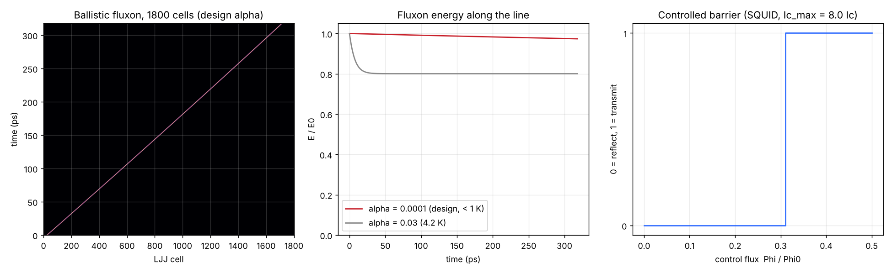

# RFL-RE1: reversible fluxon logic die on a 6-layer RF carrier

A superconducting **Reversible Fluxon Logic** (RFL) test chip — the ballistic, flux-quantum style of reversible
computing from Sandia (M. Frank et al., asynchronous ballistic reversible computing) and LPS (K. Osborn, W. Wustmann,
RFL) — wire-bonded into a red-mask, 6-layer Rogers RF carrier (KiCad 7) on a gold-plated copper package. Every 3D
layer is extruded from the exported CAD polygons, rendered in Blender Cycles, and explorable in a browser.
One parameter file drives everything: `src/design_params.py` → `./build_all.sh`.


## What the die does

Information is carried by single flux quanta (fluxons, Φ0 = h/2e) moving **ballistically** along discrete long
Josephson junctions (LJJs): chains of unbiased, unshunted Nb junctions. The logic itself draws no bias power; a fluxon
keeps its energy as it passes through the gates. Only the conventional SFQ converters at the chip edge are biased.

```
TRIG_A ─ DC/SFQ_A ─ LJJ_A ─ [controlled barrier CB] ─ LJJ_A2 ─┐            ┌─ LJJ_O0 ─ SFQ/DC_0 ─ OUT_0
                                    ▲ CTRL_CB               I0 [ rotary   ] O0
TRIG_B ─ DC/SFQ_B ─ LJJ_B ─────────────────────────────────── I1 [ element ] O1 ─ LJJ_O1 ─ SFQ/DC_1 ─ OUT_1
                                                                    ▲ CTRL_RE (state set/reset)
TEST_IN ─ DC/SFQ_T ─ 18 mm ballistic LJJ racetrack (1761 cells) ─ SFQ/DC_T ─ TEST_OUT     (time of flight)
VB_W, VB_E: DC bias for the six converters only
```

- **Controlled barrier (CB):** one LJJ node replaced by a symmetric dc SQUID (2 × 4 Ic). Flux from CTRL_CB sets its
  effective critical current, so a fluxon is either reflected or passed.
- **Rotary element (RE):** an LJJ ring with two storage junctions and four ports; the stored fluxon state steers
  incoming fluxons to O0 or O1 (Frank/Sandia ballistic rotary element). CTRL_RE sets and resets the state.
- **Racetrack:** 18 mm of LJJ between a DC/SFQ and an SFQ/DC converter, for measuring fluxon speed and loss.

3270 junctions in total; Jc 10 kA/cm², LJJ junctions 50 µA (0.5 µm²), one cell per 10 µm of 10 µm-wide M1 strip.

### Physics check (`src/rfl_sim.py`, discrete sine-Gordon model)



| Quantity | Value |
|---|---|
| Josephson inductance L_J | 6.58 pH; cell inductance 0.48 pH → Josephson length Λ = 3.7 cells (37 µm) |
| Plasma frequency | 392 GHz; fluxon speed at 0.6 c0 ≈ 55 µm/ps |
| Racetrack, design damping (T < 1 K, α = 1e-4) | fluxon crosses 1800 cells, keeps 97 % of its energy (v 0.60 → 0.57 c0) |
| Same line at 4.2 K (α ≈ 0.03) | fluxon stalls: the kinetic energy is gone within ~30 ps |
| Controlled barrier | reflects below ≈ 0.31 Φ0 of control flux, transmits above |

So the gates are meant to run **below 1 K**, which is why the die sits on a cryogenic RF carrier. This is a model of
the LJJ physics, not a full circuit simulation of the converters, the RE, or the control-line coupling (see below).

## Process stack on the die (`out/layer_stack.yaml`)

| Layer (GDS) | Material | Thickness |
|---|---|---|
| GP (1/0) | Nb ground plane | 200 nm |
| ILD0 | SiO2 | 200 nm |
| M1 (3/0) | Nb: LJJ strips, JJ base electrode | 150 nm |
| JJ (4/0) | AlOx barrier + Nb counter-electrode | 100 nm |
| ILD1, contacts I1 (5/0) | SiO2 | 200 nm |
| R (6/0) | Mo resistor, 2 Ω/sq (converter shunts and bias) | 40 nm |
| M2 (7/0) | Nb: I/O microstrip, bias, control lines, pads, JJ ground straps | 300 nm |
| PAD (8/0) | Ti/Au bond metallisation (pads + ground ring) | 100 nm |
| VIA (9/0) | stacked Nb contacts into GP | — |

Substrate: 525 µm high-resistivity Si. Each LJJ junction returns to ground through its own M2 strap and stacked via.

## The carrier (unchanged hardware, renamed nets)

40 × 40 × 1.496 mm, ENIG, red LPI mask. F.Cu GCPW (0.43/0.20 mm, 49.9 Ω) carries triggers, outputs and the racetrack
to six end-launch SMAs. VB_W, VB_E, CTRL_CB and CTRL_RE go bond pad → blind via → In2 stripline (49.3 Ω) → blind via →
B.Cu → four bottom SMPs. In1/In3 are solid GND around the stripline; In4 references the bottom routing. 324 stitching
vias, 20 signal bonds (two per pad) and 67 ground bonds onto the die's Au ground ring. KiCad DRC: 0 violations,
0 unconnected items.

## Deliverables

| Requested | File |
|---|---|
| quantum_die.gds | `out/quantum_die.gds` (cell `RFL_RE1`), KLayout previews `docs/die_preview*.png` |
| rf_carrier.kicad_pcb | `out/rf_carrier.kicad_pcb` + `.kicad_pro` / `.kicad_dru`, Gerbers + drill (blind spans separate), SVG |
| assembly.step | `out/assembly.stpZ` (gzip STEP AP214, 32 named parts, true thicknesses); `out/rf_carrier.step` (KiCad board body) |
| quantum_assembly.blend | `out/quantum_assembly.blend` |
| layer_stack.yaml / connections.json | `out/layer_stack.yaml`, `out/connections.json` |
| renders | `renders/assembled_chip.png`, `red_pcb_view.png`, `exploded_layers.png`, `internal_trace_cutaway.png`, `wirebond_macro.png`, `fluxon_gate_macro.png`, `technical_cad_view.png` |
| interactive_3d_view.html | `out/interactive_3d_view.html` + `out/assembly.glb` (serve the folder: `cd out && python3 -m http.server`) |
| validation | `docs/VALIDATION.md`: **62 checks, 62 pass** (PCB continuity, die netlist from GDS, fluxon physics, bonds, stack, 2D↔3D) |

The earlier 4-transmon die is kept as `src/build_die_transmon.py` (writes `transmon_die.gds`).

## Not settled (read before fabricating)

- **Simulated:** LJJ propagation and the barrier, in a 1D sine-Gordon model. **Not simulated:** the DC/SFQ and SFQ/DC
  converters, the rotary element's state switching, control-line mutual inductances, and junction spreads. Run JoSIM or
  WRspice with extracted inductances (InductEx) before tape-out.
- **Cell layouts are representative:** junction areas, loop shapes and resistor values follow the topology but are not
  tuned to a foundry PDK. Map the layers to the target process (e.g. MIT LL SFQ5ee) and run its DRC.
- **Temperature:** ballistic operation needs sub-gap damping α ≲ 1e-4, i.e. well below 4.2 K (dilution-fridge or ³He stage).
- **Carrier:** ENIG contains magnetic nickel and should be replaced by a Ni-free finish near superconducting circuits;
  flux trapping also calls for magnetic shielding and moats in the GP (not drawn). The connectors are generic, not
  vendor parts. Line impedances are closed-form and ignore the mask.
- **Display exaggeration:** films under 3 µm are drawn thicker in the GLB/.blend so they can be seen; the STEP and the
  thickness readouts use the true values. XY geometry is never changed.

## References

- K. D. Osborn, W. Wustmann, "Reversible Fluxon Logic: Topological particles allow ballistic gates along 1D paths", arXiv:1711.04339.
- M. P. Frank et al., "Asynchronous Ballistic Reversible Fluxon Logic", Sandia National Laboratories (2019).
- S. Kaplan et al., "Superconducting Elements for Ballistic Reversible Computing", APS March Meeting 2025.
- IEEE Spectrum, "Reversible Computing Escapes the Lab in 2025" (Vaire Computing; reversible CMOS).
- S. Huang et al., "Microwave Package Design for Superconducting Quantum Processors", PRX Quantum 2, 020306 (2021).

## Tools

KLayout 0.30 (die layout, previews), KiCad 7.0 (board, DRC, Gerber, STEP), own discrete sine-Gordon solver (numpy),
OpenCascade/OCP (assembly STEP), trimesh (GLB), Blender 5.3 Cycles via `bpy` (renders), three.js 0.160 (viewer).
