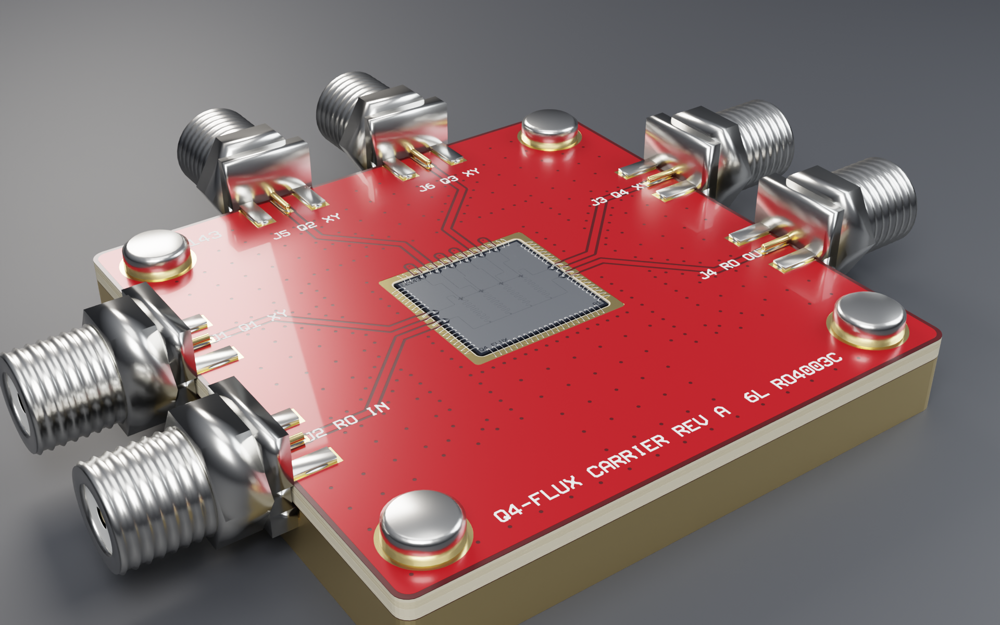
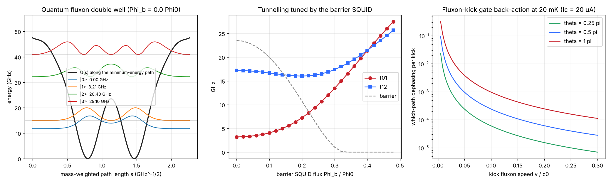
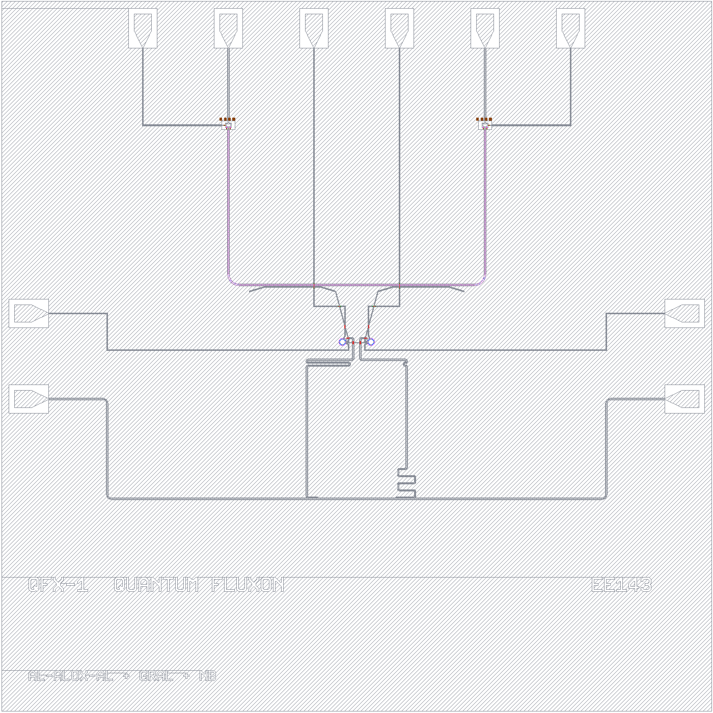

# QFX-1: a quantum-fluxon chip on a 6-layer RF carrier

QFX-1 is a superconducting processor die whose qubits are **quantum fluxons**: single Josephson vortices that tunnel
between two wells in a ring of 24 tiny junctions. A second kind of fluxon gates them: a heavy, classical one that flies
past on a ballistic line and leaves with its energy.

- **Carrier:** the die is wire-bonded into a red-mask, 6-layer Rogers RF carrier (KiCad 7) on a gold-plated copper
  package.
- **3D model:** every layer is extruded from the exported CAD polygons, rendered in Blender Cycles, and explorable in a
  browser.
- **Single source:** one parameter file, `src/design_params.py`, drives everything through `./build_all.sh`.

What is new compared with the literature, and what is not, is in **[docs/NOVELTY.md](docs/NOVELTY.md)**. Short
version: a single quantum-fluxon qubit has been demonstrated before (KIT, 2023). Gating it with another fluxon, the
momentum rule for that gate, and two coupled fluxon qubits on one chip are what we did not find. Nothing here has been
fabricated or measured.



## How it works

1. **Qubit.** One fluxon (a 2π phase kink carrying one flux quantum Φ0) is trapped in a closed ring of 24 small
   Al/AlOx/Al junctions, joined by granular-aluminium superinductors.
   - Two weaker junctions, two cells apart, make two wells for the fluxon. The junction between them is a dc SQUID that
     sets the tunnelling barrier.
   - |0⟩ and |1⟩ are the symmetric and antisymmetric superpositions of "fluxon in the left well" and "fluxon in the
     right well".
2. **Gate.** A DC/SFQ converter launches a heavy fluxon into an unbiased 7.8 mm ballistic line of 783 large junctions.
   - While it crosses a 1.2 mm section, a flux transformer tilts the qubit's double well, and the qubit picks up a
     conditional phase (Z rotation).
   - The fluxon keeps going and is detected by an SFQ/DC converter. The line itself carries no bias and dissipates
     nothing.
3. **Rule.** The heavy fluxon is delayed by an amount that depends on the qubit state: δX = ħθ/p. A gate is clean only
   if the fluxon's momentum is large compared with its thermal spread.
4. **Coupling and readout.** The two rings share a small inductance (a galvanic bus). Each ring shares 40 pH with a
   λ/4 resonator on a common feedline for dispersive readout. Drive lines tilt the wells at microwave rates.
5. **Double sweet spot.** At zero SQUID flux, f01 is first-order insensitive to both barrier-flux and tilt-flux noise.

```
  north pads:  VB_IN   KICK_TRIG        QF1_FLUX   QF2_FLUX        KICK_OUT   VB_OUT
                         DC/SFQ ┐                                    ┌ SFQ/DC
                                │ heavy-fluxon line: 783 JJ, 7.8 mm, │
                                │ Nb CPW 20 µm strip / 1 µm gaps     │
                                └──[ section 1: 1.2 mm ]──[ section 2: 1.2 mm ]──┘
                                         ║ XFMR1 (flared)    ║ XFMR2 (flared)
  QF1_DRIVE ──────────────────────── (QF1) ═════ BUS ═════ (QF2) ──────────────────────── QF2_DRIVE
                                       │ RES1 7.0 GHz        │ RES2 7.4 GHz
  FEED_IN ─────────────────────────────┴── readout feedline ─┴──────────────────────────── FEED_OUT
```

## Physics (`src/qfx_sim.py` → `out/qfx_sim.json`)



**Model.**
- *Ring spectrum:* the minimum-energy path of the 24-junction ring between the two wells (string method in
  mass-weighted phases), then a 1D Schrödinger equation along that path. It is checked against the full 24-junction
  normal modes.
- *Gate:* 24-level qubit dynamics under the kink-shaped, tapered tilt pulse. The transformer coupling κ is calibrated
  by bisection for θ = π/2.
- *Back-action:* a classical discrete sine-Gordon simulation of the line with the qubit-dependent interaction.

| Quantity | Value |
|---|---|
| Ring cell | E_J = 39.7 GHz (I_c = 79.9 nA), E_C = 8.07 GHz (C = 2.40 fF), E_L = E_J (Λ = 1, 4.12 nH of grAl per cell) |
| Double well | two pinning junctions at 0.3·E_J; barrier dc SQUID with E_J,max = 1.35·E_J |
| Operating point Φ_b = 0 | **f01 = 3.208 GHz, f12 = 17.19 GHz**, f02 = 20.40 GHz, barrier 23.5 GHz |
| Tuning | f01 from 3.21 GHz (Φ_b = 0) up to 27.5 GHz (Φ_b = 0.48 Φ0) |
| Flux noise | df01/dΦ_b = 0 at the operating point, against up to 81 GHz/Φ0 on the slope. Tilt couples only transversally (G00 − G11 = 5×10⁻⁹) |
| Model check | pinning mode 32.763 GHz from the path vs 32.768 GHz from the full Hessian (0.015 %). Next internal mode 51.1 GHz, so the fluxon motion separates from the array modes |
| Drive and tilt | G01 = 249 GHz/Φ0 on the barrier link; dε/dΦ = 625 GHz/Φ0 |
| Qubit–qubit coupling | J = L_s·ΔI²/4 = **3.79 MHz per pH** of shared inductance (ΔI = 100 nA). ZZ in the fluxon-position basis, XX in the energy basis at the sweet spot |
| Readout | 40 pH shared with a 7.0 GHz λ/4: g = 70.6 MHz, χ ≈ 1.3 MHz |
| Kick line | I_c = 20 µA, C = 600 fF, f_p = 50.65 GHz. CPW 20/1 µm gives 0.229 pH/µm → L_cell = 2.29 pH at 10 µm pitch vs L_J = 16.46 pH → Λ = 2.68 cells. c0 = 8.53 µm/ps; rest energy 213 THz·h |
| **Kick gate** (v = 0.05 c0) | 1.2 mm section with 200 µm raised-cosine ramps (2.34 ns effective dwell), κ = 2.55×10⁻³ → phase **1.5706 rad**, bit-flip **7.7×10⁻⁷**, leakage 2.6×10⁻¹² |
| **Back-action** | δX = ħθ/p: 2.008 cells (sine-Gordon) vs 2.001 cells (formula), 0.4 %. Thermal which-path dephasing per π/2 gate at 20 mK: **9.7×10⁻⁴** at 0.05 c0. Launch-speed jitter must stay below 0.9 % for a 10⁻⁴ phase error |

Kick speed trade-off, π/2 gate at 20 mK. The kinetic energy KE is ½·E0·β². Only v = 0.05 c0 was run through the full
dynamics:

| v / c0 | v (µm/ps) | dwell (ns) | KE (GHz·h) | which-path dephasing |
|---|---|---|---|---|
| 0.01 | 0.085 | 11.7 | 10.7 | 2.4×10⁻² |
| 0.02 | 0.171 | 5.86 | 42.6 | 6.0×10⁻³ |
| **0.05** | **0.427** | **2.34** | **267** | **9.7×10⁻⁴** |
| 0.1 | 0.853 | 1.17 | 1074 | 2.4×10⁻⁴ |
| 0.2 | 1.707 | 0.59 | 4394 | 6×10⁻⁵ |

## The die (`out/quantum_die.gds`, cell `QFX1`)



**Process stack.** Substrate: 525 µm high-resistivity Si.

| Layer (GDS) | Material | Thickness | Contents |
|---|---|---|---|
| BASE (1/0) | Nb | 150 nm | ground plane, feedline, λ/4 resonators, drive and flux lines, kick-line strip, transformers, bus, pads |
| GRAL (2/0) | granular Al | 20 nm | ring superinductor rails (≈0.5 nH/□) |
| AL1 (3/0) | Al | 30 nm | bottom electrodes (first evaporation angle) |
| AlOx | AlOx | ~2 nm | tunnel barrier; a junction is AL1 ∧ AL2 |
| AL2 (4/0) | Al | 60 nm | top electrodes (second angle) |
| RES (5/0) | Cu | 50 nm | converter shunt and bias resistors, quasiparticle traps |
| ABP / ABS (6/0, 7/0) | Al | 3 µm posts / 400 nm spans | 10 airbridges where lines cross |
| 63/0, 64/0 | (documentation) | — | route centre lines; patches that tie line ends to ground (validation removes them to test isolation) |

**Junctions.** All 837 come from one Al/AlOx/Al step (Jc = 1.665 µA/µm², 50 fF/µm²), so each area fixes both I_c and
C:

| Junction | Count | Area | I_c | C |
|---|---|---|---|---|
| ring rung | 42 | 0.048 µm² | 80 nA | 2.40 fF |
| pinning (well) | 4 | 0.0144 µm² | 24 nA | 0.72 fF |
| barrier SQUID | 4 | 0.0324 µm² | 54 nA | 1.62 fF |
| kick line | 783 | 12.0 µm² | 20 µA | 600 fF |
| DC/SFQ + SFQ/DC | 4 | 12.0 µm² | 20 µA | 600 fF |

The kick-line junctions overlap the strip edge: AL1 wraps the strip edge and AL2 crosses the 1 µm gap onto ground.

The readout resonators are 4291.3 µm (7.0 GHz) and 4059.2 µm (7.4 GHz), with ε_eff = (ε_r + 1)/2.

## The carrier

40 × 40 × 1.496 mm, 6-layer RO4003C/RO4450F, ENIG, red LPI mask.

- **Top side:** F.Cu GCPW (0.43/0.20 mm, 49.9 Ω) carries KICK_TRIG, KICK_OUT, QF1/QF2_DRIVE and FEED_IN/OUT to six
  end-launch SMAs.
- **Bottom side:** VB_IN, VB_OUT (converter bias) and QF1/QF2_FLUX (fluxon trapping and barrier trim) run bond pad →
  blind via → In2 stripline (49.3 Ω) → blind via → B.Cu → four bottom SMPs.
- **Ground:** In1/In3 are solid ground around the stripline, and 324 stitching vias tie the planes together.
- **Bonds:** 20 signal bonds (two per pad) and 67 ground bonds onto the die ground.
- **KiCad DRC:** 0 violations, 0 unconnected items.

## Deliverables

| Requested | File |
|---|---|
| quantum_die.gds | `out/quantum_die.gds` (cell `QFX1`), KLayout previews `docs/die_preview*.png` |
| rf_carrier.kicad_pcb | `out/rf_carrier.kicad_pcb` + `.kicad_pro` / `.kicad_dru`, Gerbers + drill (blind spans separate), SVG |
| assembly.step | `out/assembly.stpZ` (gzip STEP AP214, named parts, true thicknesses); `out/rf_carrier.step` (KiCad board body) |
| quantum_assembly.blend | `out/quantum_assembly.blend` |
| layer_stack.yaml / connections.json | `out/layer_stack.yaml`, `out/connections.json` |
| renders | `renders/assembled_chip.png`, `red_pcb_view.png`, `exploded_layers.png`, `internal_trace_cutaway.png`, `quantum_fluxon_macro.png`, `wirebond_macro.png`, `technical_cad_view.png` |
| interactive_3d_view.html | `out/interactive_3d_view.html` + `out/assembly.glb` (serve the folder: `cd out && python3 -m http.server`) |
| physics | `out/qfx_sim.json`, `docs/qfx_sim.png` |
| validation | `docs/VALIDATION.md`: **86 checks, 86 pass**. Covers PCB continuity and DRC, die netlist from the GDS, the single junction process, fluxon physics, the gate and back-action, bonds, the stack, and 2D↔3D consistency |
| novelty | `docs/NOVELTY.md`: prior art, what is new, and how the search was done |

Earlier designs stay in the pipeline:
- the reversible-fluxon-logic die RFL-RE1: set `ACTIVE_DIE = "RFL"`;
- the 4-transmon die: `src/build_die_transmon.py`.

## Not settled (read before fabricating)

**Not simulated:**
- the EM coupling of the flared transformers (κ = 2.55×10⁻³ is a target; the raised-cosine profile stands in for the
  flare), the bus and the readout taps — extract them with Sonnet, InductEx or similar;
- the DC/SFQ and SFQ/DC converters (cell layouts are placeholders; run JoSIM or WRspice);
- the real launch-speed spread of the converter;
- T1 and T2: no noise or loss model beyond the which-path back-action;
- quasiparticles and radiation in the 7.8 mm line.

**Loading the fluxon:** one Φ0 has to be trapped in each ring, by field-cooling or by a pulse on QFx_FLUX with the
barrier lowered. This is not modelled.

**Fabrication spread:** f01 depends steeply on the barrier junction (f01 rises from 3.2 to 3.9 GHz when E_J,max drops
from 1.35 to 1.30·E_J), and the SQUID can only raise f01. Aim the barrier junction slightly large and trim with flux,
moving off the exact sweet spot. The grAl inductance (Λ = 1) also varies run to run.

**Kick line:** Λ comes from closed-form CPW formulas (Nb λ_L = 90 nm). The junctions sit on the strip edge, which
needs an ion-mill contact. The Peierls–Nabarro barrier at Λ = 2.7 is negligible, but losses at 20 mK are assumed
negligible, not computed.

**Carrier:**
- ENIG contains magnetic nickel; use a Ni-free finish near the die.
- Flux trapping calls for magnetic shielding and ground-plane moats, which are not drawn.
- The connectors are generic, not vendor parts, and the line impedances are closed-form.

**Display exaggeration:** films under 3 µm are drawn thicker in the GLB and the .blend so they can be seen. The STEP
and the thickness readouts use the true values, and XY geometry is never changed.

## References (full prior-art table in docs/NOVELTY.md)

- A. Wallraff et al., "Quantum dynamics of a single vortex", *Nature* 425, 155 (2003).
- KIT PhD thesis, "Quantum Tunneling of Josephson Vortices in High-Impedance Long Junctions" (2023), doi:10.5445/IR/1000158804; M. Wildermuth et al., *Appl. Phys. Lett.* (2022), doi:10.1063/5.0082197.
- S. S. Seidov, M. V. Fistul, "Quantum dynamics of a single fluxon in Josephson junctions parallel arrays with large kinetic inductances", *Phys. Rev. A* 103, 062410 (2021).
- D. V. Averin, K. Rabenstein, V. K. Semenov, "Rapid ballistic readout for flux qubits", *Phys. Rev. B* 73, 094504 (2006).
- K. D. Osborn, W. Wustmann, "Reversible Fluxon Logic", arXiv:1711.04339; W. Wustmann, K. D. Osborn, fluxon-transmission readout, arXiv:2504.18915.
- S. Matsuo et al., "Fluxon-based gate controls of capacitively coupled flux-based-phase qubits", *Appl. Phys. Lett.* 91, 093103 (2007).
- M. V. Fistul, A. V. Ustinov, "Josephson vortex interaction mediated by cavity modes", *Phys. Rev. B* 68, 132509 (2003).
- S. Huang et al., "Microwave Package Design for Superconducting Quantum Processors", *PRX Quantum* 2, 020306 (2021).

## Tools

- KLayout 0.30: die layout and previews.
- KiCad 7.0: board, DRC, Gerber and STEP.
- numpy/scipy: our own string-method, multilevel-dynamics and discrete sine-Gordon solvers.
- OpenCascade/OCP: assembly STEP.
- trimesh: GLB.
- Blender 5.3 Cycles via `bpy`: renders.
- three.js 0.160: viewer.

Literature search: Undermind, Lune, alphaXiv, SciSpace, Valency and Paperguide; unit checks in Wolfram|Alpha. See
docs/NOVELTY.md.
